# Diagramas de flujos y relaciones de LaundryWeb

Estos diagramas describen la Web actual como demostración. Las flechas representan acciones o relaciones implementadas; no implican sincronización con LaundryApp, LaundryDriver ni un backend. Los controles rotulados «MVP» representan al cliente o al chofer desde la propia consola.

## 1. Cómo se relacionan los módulos

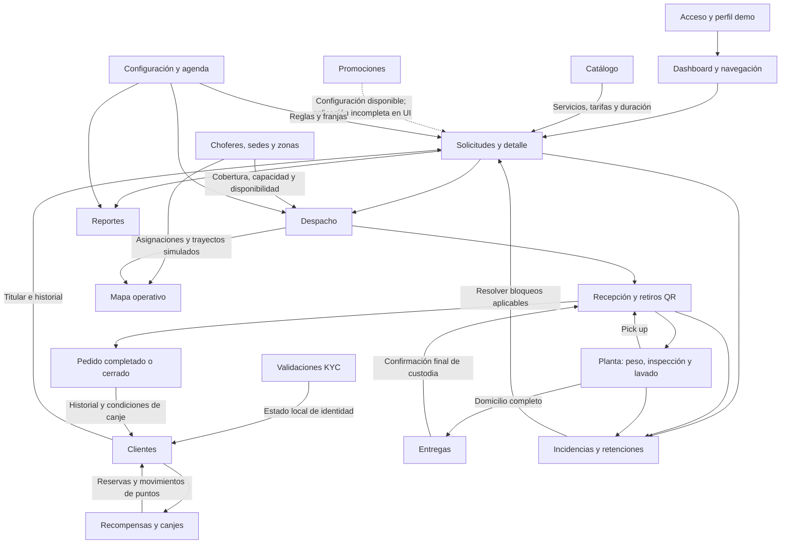

La solicitud es el vínculo central: referencia al cliente, servicio, sede y choferes; sus transferencias, incidencias, ajustes, pagos y mensajes usan el identificador del pedido. KYC actualiza la ficha del cliente; no representa una validación externa. Las promociones existen como configuración, pero no hay un recorrido completo visible para consumir un cupón desde esta consola.

## 2. Acceso, perfiles y navegación común

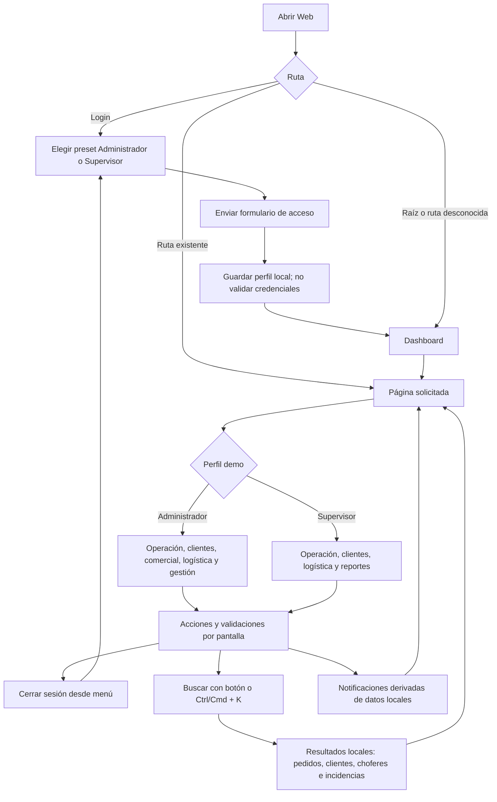

No hay un guard global de autenticación. El menú y varias acciones se adaptan al rol; las páginas administrativas incorporan restricciones propias. Cerrar sesión navega al login, pero conserva el perfil local. «Recordarme» y recuperación de contraseña no ejecutan un proceso de sesión real.

## 3. Recorrido completo del pedido

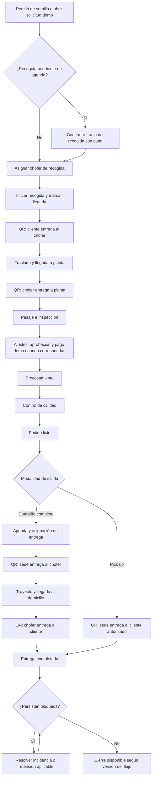

Ambas modalidades empiezan con recogida a domicilio. No se ofrece ingreso inicial del cliente en el local. Los registros antiguos pueden conservar constancias de ingresos anteriores, sin habilitar nuevas entregas iniciales en sede.

## 4. Lista y detalle de solicitudes

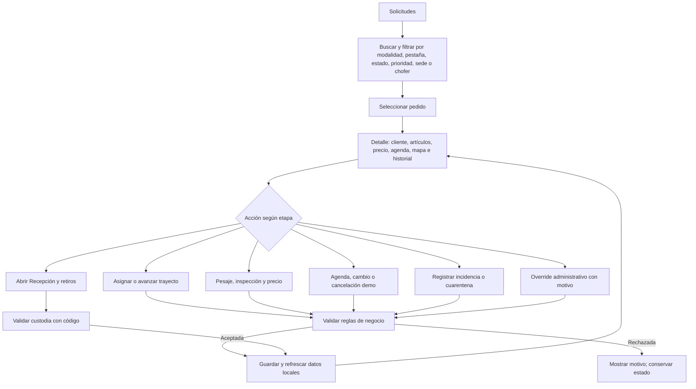

La lista no contiene un formulario general de alta. «Abrir solicitud de demostración» en Despacho crea o reutiliza `SOL-DEMO-001`. Los botones del detalle dependen de la etapa y de la versión de negocio; algunos estados físicos solo avanzan mediante custodia QR.

## 5. Despacho y selección de chofer

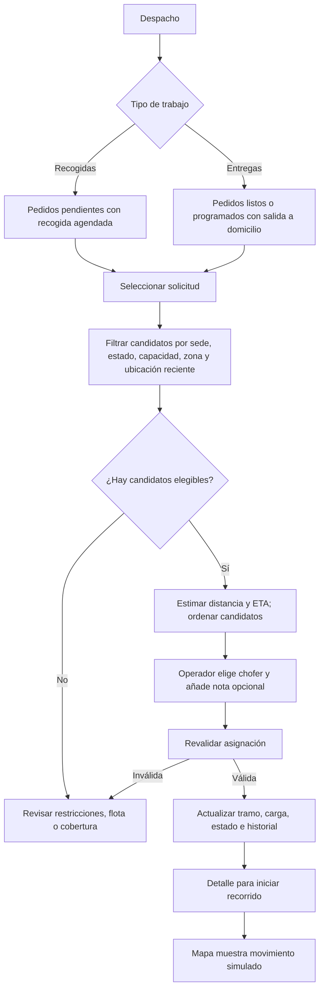

La sugerencia no asigna sola. En modo demo, los tiempos y posiciones no provienen del tráfico ni del teléfono de un conductor.

## 6. Validación QR y custodia

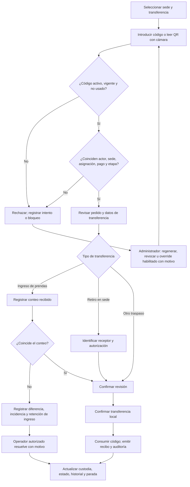

Los códigos son de un solo uso y cinco intentos inválidos pueden bloquearlos. La cámara actúa como lector local; el código no verifica físicamente la identidad o la entrega. El control para representar al chofer asignado permite ensayar ese actor desde la Web.

## 7. Pesaje, ajustes, aprobación y pago

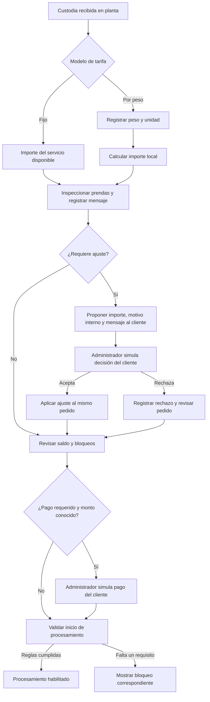

El rechazo no se dibuja como aprobación automática: el servicio vuelve a evaluar las condiciones del pedido. Los registros de pago no generan cobros, facturas o reembolsos reales.

## 8. Agenda, cambios, cancelación y cargos

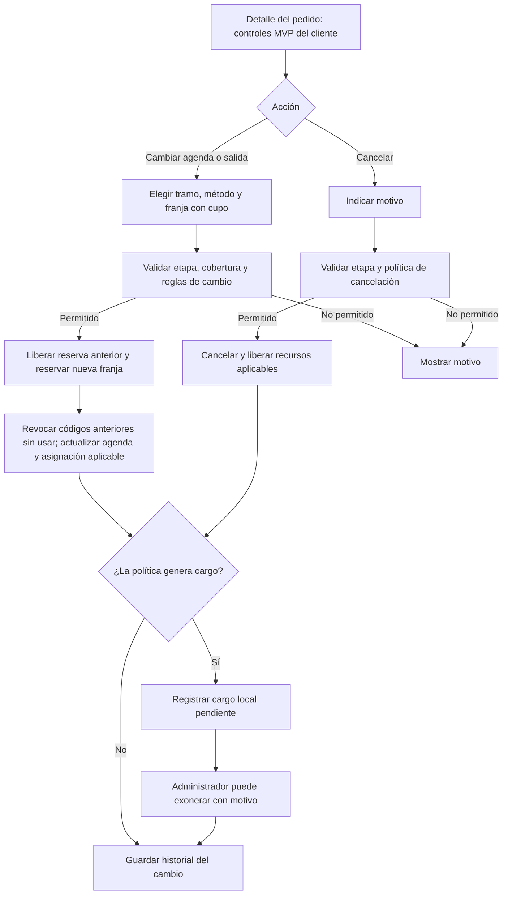

Solo el tramo de salida permite alternar domicilio y retiro en sede. Los cambios de entrada mantienen recogida a domicilio. Las reglas y cargos dependen de la política local de demo; una cancelación no devuelve dinero mediante una pasarela.

## 9. Planta y cuarentena

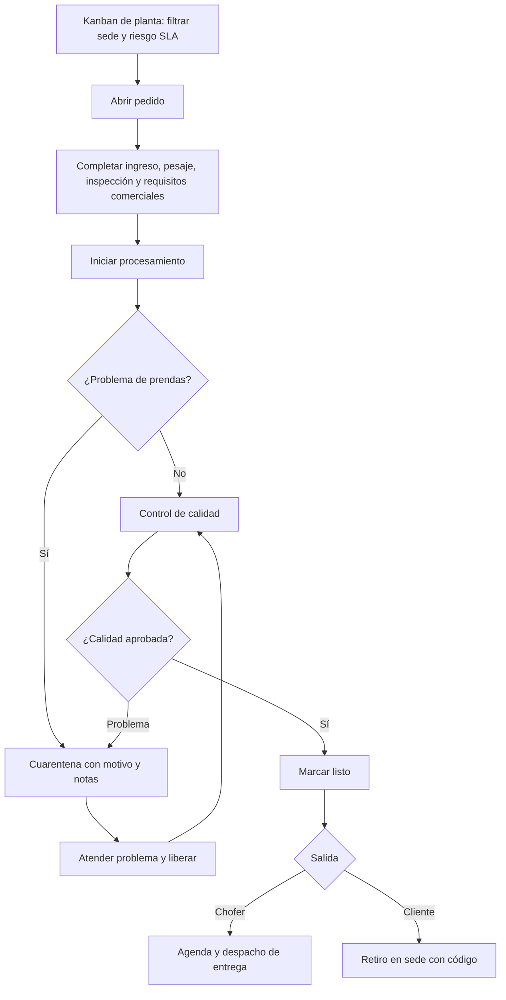

El kanban contiene etapas de varias versiones del flujo. Para peso, ajustes, aprobación y pago del flujo comercial nuevo, el detalle reúne los controles pertinentes.

## 10. Entrega a domicilio y retiro en sede

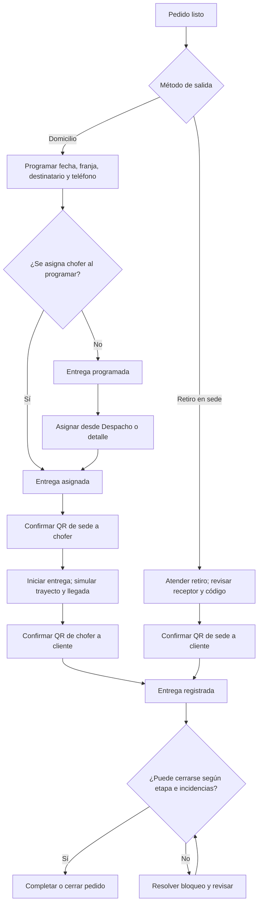

La tabla Entregas incluye salida por chofer. Los retiros del cliente se gestionan en Recepción y retiros. El botón visible para confirmar una entrega no permite eludir los requisitos de custodia.

## 11. Incidencias, retenciones y recuperación

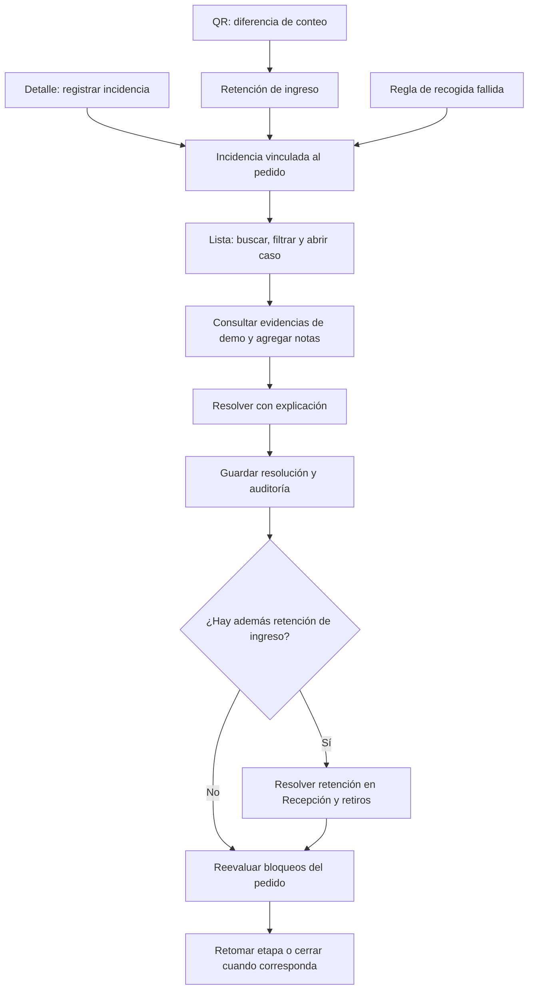

La tabla permite consultar, anotar y resolver; el alta manual está en el detalle de una solicitud. Las evidencias que genera ese formulario son placeholders. Resolver el caso y liberar una retención son acciones relacionadas pero distintas.

## 12. Clientes, pedidos, KYC y puntos

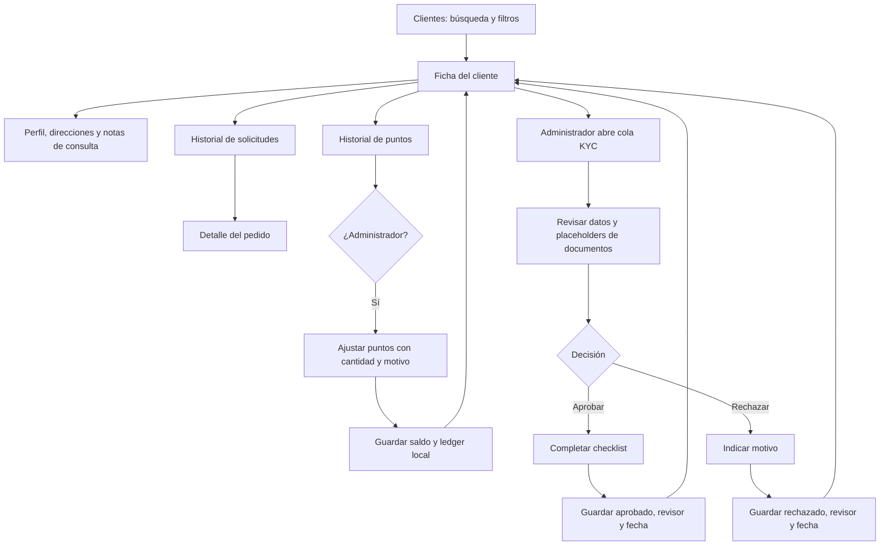

No hay alta o edición general de clientes en esta página. KYC no analiza imágenes ni valida identidad y no añade por sí solo una autenticación real.

## 13. Catálogo y promociones

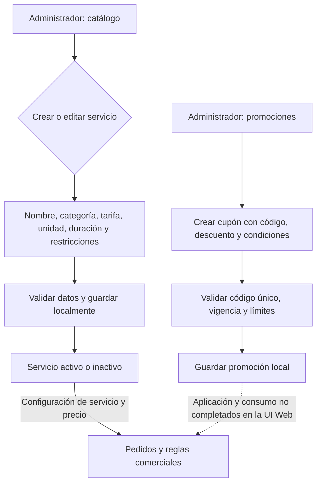

El catálogo permite edición y estado activo/inactivo. Promociones ofrece creación; no hay un recorrido de edición o un botón completo para consumir cupones en pedidos desde la consola actual.

## 14. Recompensas y canjes

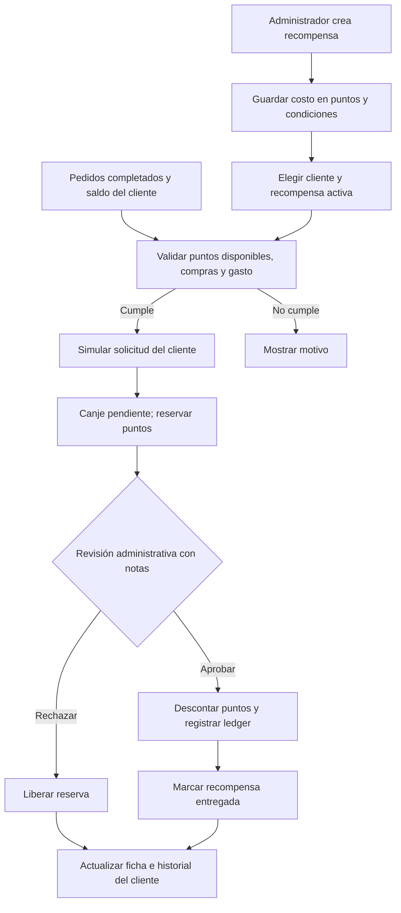

La solicitud del cliente se representa desde la pestaña de canjes. La reserva evita considerar disponibles los mismos puntos para otro canje pendiente; la aprobación produce el débito local.

## 15. Zonas, sedes y flota

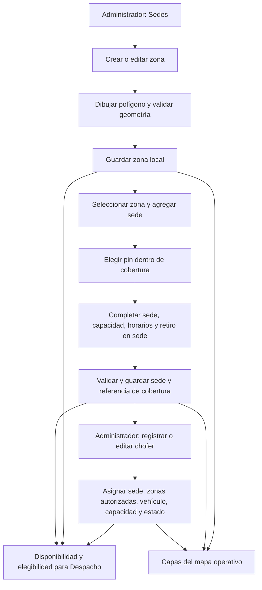

El Supervisor consulta estos datos. Una zona puede contener varias sedes; la sede de referencia mantiene la regla de cobertura existente. Agregar sedes no reasigna automáticamente pedidos. Hay restricciones para cambiar cobertura, estado o ubicación cuando existen operaciones activas.

## 16. Mapa, capas y seguimiento simulado

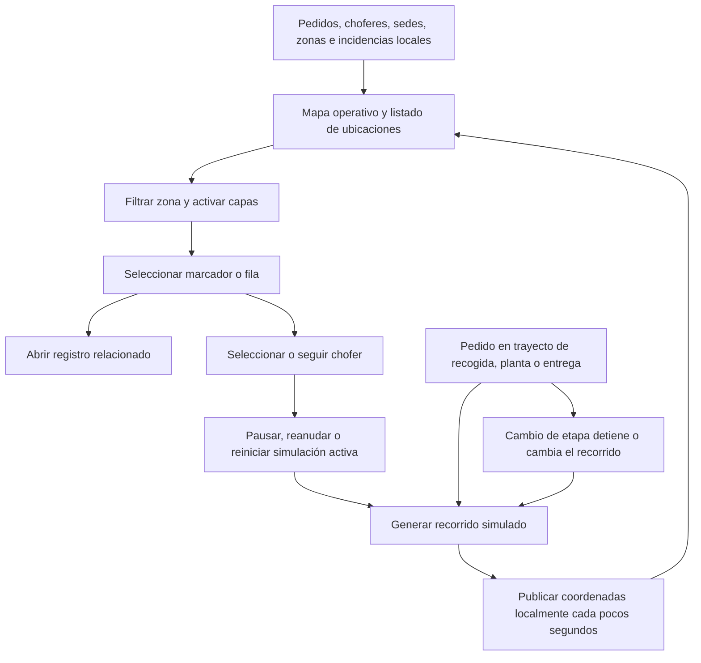

Las flechas de seguimiento solo actualizan posiciones. Las etapas del pedido y la custodia avanzan mediante sus acciones operativas. La configuración permite un proveedor geográfico externo opcional, pero el tracking predeterminado sigue siendo mock y el negocio continúa local.

## 17. Chat y avisos

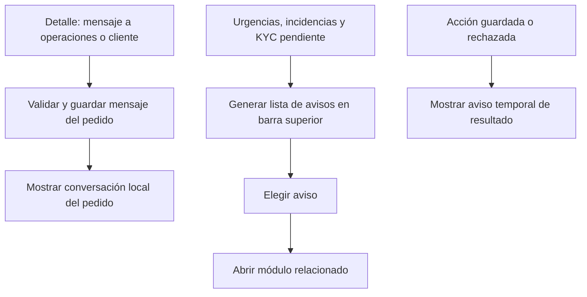

Estos mensajes, avisos y conversaciones no se entregan por email, push o SMS ni aparecen automáticamente en otra aplicación.

## 18. Dashboard, reportes y exportación

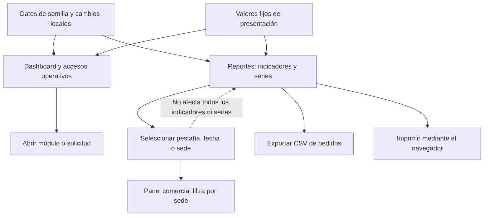

La exportación utiliza todos los pedidos y no sigue todos los filtros visuales. Las series, pestañas y fechas no constituyen un informe temporal consistente. Pagos e ingresos son importes de demostración.

## 19. Configuración y reinicio

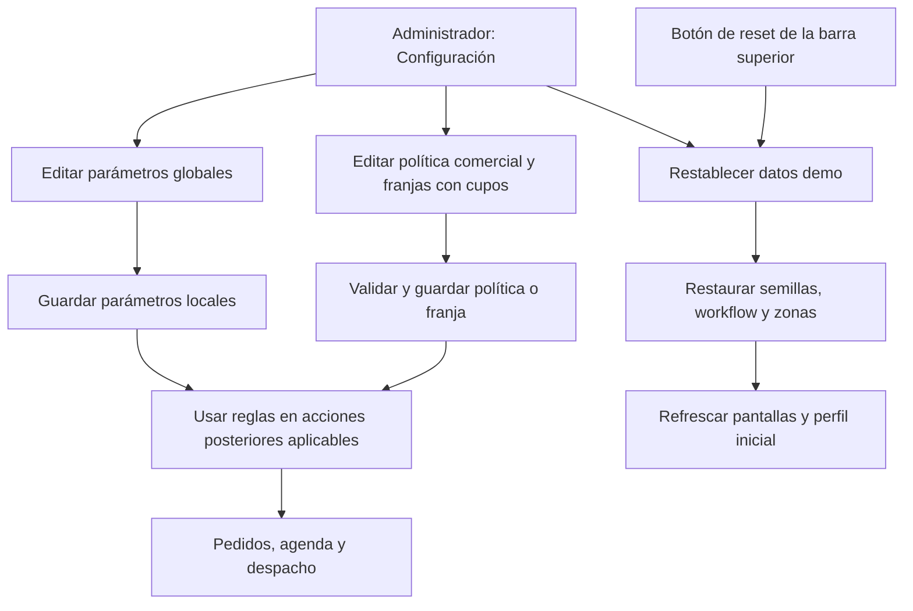

El reset afecta la demo Web del navegador y se ejecuta sin confirmación previa. No sincroniza ni reinicia los otros repositorios.

## 20. De dónde salen los datos y qué se comparte

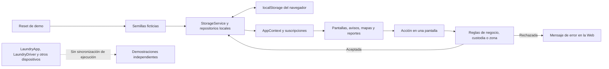

Las escrituras no son solicitudes HTTP a un servidor. El workflow local enlaza pedidos con transferencias, recibos, ajustes, pagos, reservas, mensajes y auditoría; otras claves conservan catálogo, promociones, parámetros y zonas. Recargar conserva los cambios del mismo origen y perfil del navegador. Un perfil u origen distinto mantiene datos distintos.

## Referencias

- [Explicación completa de los flujos y límites actuales](FLUJOS-WEB-DEMO.md)
- [Modalidades y custodia](../FULFILLMENT-MVP.md)
- [Zonas y sedes](../LOGISTICS-ZONES-MVP.md)
- [Geografía y simulación](../GEO-MVP.md)

Los diagramas documentan las pantallas y servicios existentes. Las limitaciones de UI descritas en la guía —como el detalle de auditoría histórica de custodia no accesible desde las pestañas visibles— siguen aplicando.
