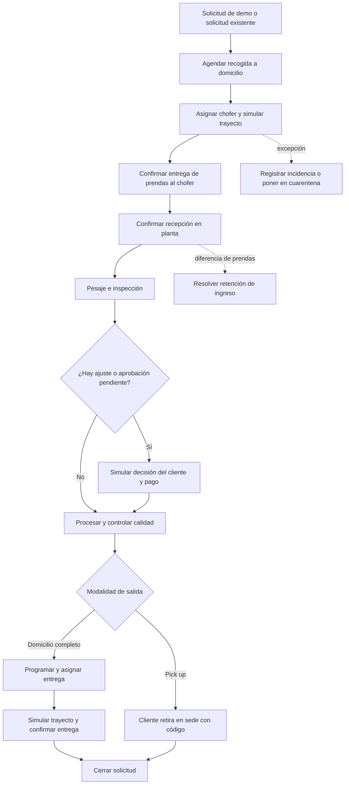

# Guía de flujos de LaundryWeb

Esta guía explica las pantallas, acciones y recorridos operativos disponibles en LaundryWeb. Describe el comportamiento que existe en el código y los datos ficticios que utiliza el MVP; no es una especificación de un servicio productivo.

Consulta también los [21 diagramas de flujos y relaciones](DIAGRAMAS-FLUJOS-WEB.md) para seguir visualmente cada recorrido y sus conexiones.

## Qué es esta demostración

LaundryWeb permite ensayar la operación de una lavandería desde la solicitud hasta la devolución de las prendas. La interfaz incluye dos perfiles de demostración: Administrador y Supervisor. Las solicitudes, personas, sedes, choferes, cobros, validaciones, reportes, notificaciones y cambios de estado se procesan localmente en el navegador.

Los datos iniciales proceden de `src/services/mockData.ts`. `src/services/storage.ts` guarda las ediciones en `localStorage`; `src/context/AppContext.tsx` las comparte entre las pantallas de esta instancia. Los cambios sobreviven a una recarga en el mismo perfil del navegador, pero no se envían a un servidor ni se comparten con otros equipos o con LaundryApp. Restablecer la demo repone las semillas locales.

La cartografía también usa el proveedor demo por defecto cuando no se configura un proveedor externo. En ese modo, las direcciones son ejemplos, la distancia y la duración son estimaciones geométricas y el movimiento de choferes es simulado. Las variables de configuración geográfica están descritas en `.env.example`; el backend geográfico está desactivado por defecto. Que se muestre una dirección, un pago, una identidad o una posición en pantalla no significa que se haya verificado o registrado fuera de esta demo.

## Entrar y cambiar de perfil

1. Abre `/login`.
2. Elige el preset **Carlos Mendoza · Administrador** o **Elena Rostova · Supervisor**.
3. Pulsa **Iniciar sesión** para abrir el dashboard.

El correo y la contraseña son campos visuales requeridos por el formulario; la aplicación no los valida contra una cuenta. **Recordarme** no cambia la duración de la sesión y **¿Olvidaste tu contraseña?** no ejecuta recuperación. Cerrar sesión vuelve a la página de acceso, pero no revoca una sesión en un servidor. Los perfiles y sus permisos son una simulación para recorrer la interfaz.

El menú lateral adapta las opciones al perfil. Comercial, Validaciones KYC y Configuración son opciones de Administrador. Algunas páginas esconden las acciones de escritura al Supervisor y otras muestran un aviso de acceso restringido. No hay una capa global de autenticación que proteja todas las rutas; estos perfiles sirven para la demostración, no para controlar acceso real.

## Navegación

| Módulo | Ruta | Qué permite recorrer |
| --- | --- | --- |
| Inicio | `/dashboard` | Resumen y accesos a la operación. |
| Operaciones | `/operations/orders` | Buscar, filtrar y abrir solicitudes. |
| Operaciones | `/operations/orders/:id` | Ver y avanzar una solicitud, gestionar su ciclo comercial y registrar una incidencia. |
| Operaciones | `/operations/handoffs` | Validar recogidas y entregas de custodia mediante códigos de demo. |
| Operaciones | `/operations/dispatch` | Asignar choferes para recogidas y entregas. |
| Operaciones | `/operations/plant` | Ver las solicitudes por etapa de planta y continuar su procesamiento. |
| Operaciones | `/operations/deliveries` | Programar y consultar entregas a domicilio. |
| Operaciones | `/operations/incidents` | Consultar y actualizar incidencias. |
| Clientes | `/customers` | Buscar clientes y consultar su perfil, pedidos y puntos. |
| Clientes | `/customers/kyc` | Revisar solicitudes de validación KYC (Administrador). |
| Comercial | `/commercial/catalog` | Crear y editar servicios del catálogo (Administrador). |
| Comercial | `/commercial/promotions` | Crear cupones promocionales (Administrador). |
| Comercial | `/commercial/rewards` | Gestionar recompensas y ensayar solicitudes de canje (Administrador). |
| Comercial | `/commercial/memberships` | Crear y editar planes de membresía (Administrador). |
| Logística | `/logistics/drivers` | Consultar la flota; el Administrador puede registrar y editar choferes. |
| Logística | `/logistics/facilities` | Consultar sedes y zonas; el Administrador puede crear y editar ambas. |
| Logística | `/logistics/map` | Consultar capas operativas y recorridos simulados. |
| Gestión | `/reports` | Ver indicadores y descargar el resumen disponible. |
| Gestión | `/settings` | Editar reglas de demo y restablecer los datos (Administrador). |

`/` dirige al dashboard. Una ruta no reconocida también redirige allí. Las páginas se cargan bajo demanda al navegar.

El dashboard resume datos locales y enlaza con las pantallas operativas. Algunas tarjetas y valores del gráfico son cifras fijas de presentación, así que deben leerse como contenido de demostración y no como un corte confiable de actividad.

### Herramientas comunes

- **Menú lateral:** se puede expandir o compactar en pantallas grandes; en pantallas pequeñas se abre como panel. La preferencia de ancho se conserva localmente.
- **Búsqueda global:** el botón de búsqueda o `Ctrl+K` / `Cmd+K` abre la búsqueda. Busca hasta cuatro resultados por grupo entre solicitudes, clientes, choferes e incidencias. `Escape` cierra el panel; elegir un resultado abre su página.
- **Notificaciones:** reúne solicitudes urgentes activas, incidencias abiertas o en curso y, para el Administrador, clientes con KYC pendiente. Cada elemento lleva a su módulo. Son avisos derivados de los datos locales, no mensajes enviados a una persona.
- **Restablecer datos demo:** el botón de ajustes de la barra superior ejecuta el mismo reinicio que Configuración. No muestra una confirmación previa y afecta los datos de demo de esta Web.
- **Mensajes emergentes:** los avisos de éxito, error e información confirman el resultado local de una acción y desaparecen al poco tiempo.

## Recorrido principal de una solicitud

La operación tiene dos modalidades de salida. Ambas empiezan con recogida a domicilio; en **Domicilio completo** un chofer también entrega en el domicilio, mientras que en **Pick up** el cliente retira el pedido listo en una sede. La entrega inicial de prendas por parte del cliente en el local no está disponible.

Los nombres de estado que aparecen en las tablas y filtros pueden variar según la versión del flujo de una solicitud. Las etapas físicas de custodia requieren validar el código correspondiente en **Recepción y retiros**; cambiar un estado desde otra pantalla no sustituye esa confirmación.

Como referencia para pedidos del flujo operativo clásico, las etapas visibles son: `PICKUP_PENDING` → `PICKUP_ASSIGNED` → `HEADING_TO_PICKUP` → `ARRIVED_FOR_PICKUP` → `PICKED_UP` → `HEADING_TO_FACILITY` → `ARRIVED_AT_FACILITY` → `AT_FACILITY` → `IN_PROCESS` → `QUALITY_CONTROL` → `READY_FOR_DELIVERY` → `DELIVERY_SCHEDULED` o `DELIVERY_ASSIGNED` → `OUT_FOR_DELIVERY` → `ARRIVED_FOR_DELIVERY` → `DELIVERED` → `CLOSED`. Las confirmaciones de custodia mueven la solicitud entre algunas de estas etapas. Los pedidos del flujo comercial más nuevo registran además estados y eventos propios en `BusinessService`; el modal de Planta permite consultar esos pasos junto con el historial del pedido.

### Solicitudes: lista y detalle

En **Operaciones → Solicitudes** puedes buscar por identificador, tracking o cliente; filtrar por modalidad, pestaña rápida, estado, prioridad, sede y chofer; y abrir una fila para consultar el detalle. Los filtros viven en la pantalla mientras está montada. Los avisos de excepciones llevan a las solicitudes afectadas.

El detalle reúne datos de cliente y direcciones, modalidad, prioridad y SLA, artículos y precios, etapas, historial, mapa y acciones disponibles en el estado actual. Las acciones de cabecera son contextuales: asignar la recogida, iniciar el recorrido, registrar llegada, trasladar a planta, iniciar procesamiento, pasar a control de calidad, marcar listo, asignar entrega, iniciar entrega, registrar llegada o cerrar. También se puede abrir **Recepción y retiros** para confirmar una transferencia.

El botón de asignación en la lista y el detalle abre el selector de choferes. Un Administrador puede aplicar el override administrativo si las reglas lo permiten y escribir el motivo requerido. Los cambios rechazados por una regla de negocio muestran un aviso; las notas y los cambios aceptados se reflejan en el historial local.

No hay un formulario general para que una persona externa cree una solicitud. En **Despacho**, **Abrir solicitud de demostración** crea o vuelve a utilizar el pedido preparado `SOL-DEMO-001` para ensayar el flujo.

### Despacho de recogida o entrega

**Operaciones → Despacho** separa las asignaciones de recogida y las de entrega. El operador selecciona una solicitud y revisa candidatos antes de confirmar la asignación; puede añadir una nota. La elegibilidad considera disponibilidad, capacidad, sede, zona autorizada, ubicación reciente y cobertura de la dirección. La lista prioriza candidatos según factores de distancia/ETA, zona, carga y desempeño; las estimaciones del proveedor demo no son tiempos de tráfico en vivo.

Al asignar, el almacenamiento local actualiza el tramo de la solicitud, el chofer, el estado, el historial y la carga de la flota. Después se inicia manualmente el recorrido desde el detalle. El filtro de chofer del formulario de asignación y la lógica de cobertura reducen candidatos; el operador confirma la decisión.

### Recepción y retiros: códigos de custodia

Esta pantalla registra el traspaso entre cliente, chofer y sede. Las pestañas agrupan transferencias que esperan el retiro del cliente, transferencias de chofer y el historial. El ingreso directo del cliente a la sede está desactivado. Los pasos habituales son:

1. Seleccionar la transferencia que corresponde y la sede.
2. Ingresar el código de seis dígitos o el contenido QR `laundry://handoff/...`; en un navegador compatible sobre `localhost` o HTTPS también se puede usar la cámara.
3. Verificar el código y leer los datos del pedido.
4. Confirmar que se revisó la transferencia y completar los datos requeridos.
5. Confirmar para registrar el recibo, el evento de historial y el siguiente estado operativo.

Los traspasos cubren: cliente → chofer, chofer → planta, planta → chofer, chofer → cliente y sede → cliente. El código de chofer corresponde al asignado. El control rotulado para representar al chofer permite al Administrador ensayar esa identidad dentro de la demo; no verifica una aplicación de chofer. Los traspasos de planta requieren un operador de la sede correspondiente.

En un ingreso se registra el conteo recibido. Si no coincide con lo declarado, el sistema deja una retención de ingreso y una incidencia vinculada; hace falta que un operador autorizado resuelva la diferencia con un motivo antes de continuar. Para el retiro por una persona en sede, se pide su nombre y relación o autorización. Los códigos vencen, son de un solo uso y tienen un límite de intentos. El Administrador puede regenerar o revocar un código activo y aplicar un override con motivo en los casos habilitados. Estas verificaciones corren en el navegador y no prueban quién está físicamente presente.

### Planta: pesaje, inspección y procesamiento

**Operaciones → Planta de lavado** muestra una lista de pedidos con línea de proceso y filtros por búsqueda, sede, etapa y riesgo de SLA. Abrir un pedido muestra un modal con resumen, prendas, gestión del proceso e historial y bitácora. La lista se adapta a escritorio y móvil y prioriza los pedidos con riesgo de SLA. La línea representa Recepción → Pesaje → Inspección → Precio y pago → Lavado → Calidad → Listo; el pesaje figura como no aplicable en servicios de precio fijo. No representa tiempo transcurrido.

El modal separa **Resumen y prendas**, **Gestionar proceso** e **Historial y bitácora**. Reúne eventos, auditoría, pesajes, ajustes, pagos demo, mensajes, constancias de custodia e incidencias disponibles para ese pedido. Permite abrir el detalle general y acceder a Recepción y retiros; la validación QR sigue en esa pantalla. El proceso comercial conserva pesaje, inspección, ajustes, comunicación, simulación de decisión/pago y avance del procesamiento.

1. Confirmar que el ingreso a planta quedó recibido mediante el código de custodia.
2. Registrar el peso si el servicio cobra por peso.
3. Revisar prendas y guardar el mensaje de inspección.
4. Si aparece un ajuste, proponer el importe y el motivo. El mensaje al cliente se registra en la solicitud.
5. Como Administrador, elegir **MVP: cliente acepta** o **MVP: cliente rechaza** para ensayar la decisión. Si el importe está disponible, también se puede simular el pago.
6. Iniciar procesamiento, pasar a control de calidad y marcar listo.
7. Si hay un problema, enviar a cuarentena; liberar la cuarentena devuelve el pedido al control de calidad.

El actor cliente de esas decisiones es una función interna de demo, no un portal ni una respuesta recibida desde el cliente. Pesos, importes, impuestos, pagos y ajustes no se conectan con básculas, pasarelas de pago o facturación real. Las reglas del servicio validan los pasos necesarios y dejan marcas locales de auditoría.

### Entrega a domicilio y retiro en sede

Para **Domicilio completo**, una solicitud lista se agenda en **Operaciones → Entregas** o desde el detalle. Se eligen fecha, franja, destinatario y teléfono; se puede asignar un chofer en la agenda o asignarlo después en Despacho. Con chofer, la etapa queda asignada; sin él, queda programada. Luego se inicia el recorrido, se registra la llegada y se confirma el código de custodia chofer → cliente en Recepción y retiros. La acción **Confirmar entregado** de la lista no basta por sí sola para saltar la verificación QR.

Para **Pick up**, el tramo de salida es retiro del cliente en sede. Se ensaya el cambio de agenda o la confirmación del retiro con el código sede → cliente desde Recepción y retiros; no se crea una ruta de entrega a domicilio.

En los dos casos la solicitud se puede cerrar cuando la entrega está confirmada y no quedan incidencias abiertas que impidan el cierre.

### Incidencias y cuarentena

Una incidencia se puede registrar desde el detalle de una solicitud. La tabla de incidencias permite consultar, añadir notas y resolver casos. El formulario de alta solicita tipo, severidad y descripción; la evidencia incluida por el detalle es una referencia vacía de demostración, no una foto subida. La recogida fallida o una diferencia de prendas también pueden dejar registros relacionados con el pedido.

En **Operaciones → Incidencias** se busca por identificador, pedido, cliente o descripción, y se filtra por estado. Al abrir un caso en un modal central se pueden agregar notas internas y resolverlo con una explicación. La resolución queda en el historial local. Una incidencia abierta puede bloquear el cierre o un traspaso según su tipo y etapa.

La cuarentena es una acción específica del detalle durante el procesamiento. Debe llevar razón y puede incluir notas; la orden no puede marcarse lista mientras siga en cuarentena. Liberarla registra el avance al control de calidad. Resolver una incidencia general no resuelve automáticamente una retención de ingreso: esa retención se atiende en Recepción y retiros.

## Clientes y funciones comerciales

### Clientes

En **Clientes → Clientes**, ambos perfiles pueden buscar por nombre, correo, teléfono o documento, filtrar por membresía o KYC y abrir una ficha de consulta en un modal central. La ficha muestra perfil, direcciones, notas, solicitudes e historial de puntos. Elegir una solicitud abre su detalle.

El Administrador puede registrar un ajuste manual de puntos con cantidad positiva o negativa y motivo. El resultado se anota en el ledger local. Esta pantalla no crea ni edita clientes, membresías, direcciones, billeteras ni pedidos.

### Validaciones KYC (Administrador)

La cola presenta clientes pendientes. Al seleccionar una ficha se revisan los datos declarados y una lista de controles. Aprobar requiere que los controles estén marcados; rechazar requiere un motivo. El resultado guarda estado, fecha, revisor y motivo.

La documentación y selfie son placeholders, los checks no analizan documentos y no hay prueba de vida ni validación de identidad. Las métricas mostradas tampoco equivalen a una auditoría externa.

### Catálogo (Administrador)

Desde **Comercial → Catálogo** se consulta el catálogo por pestañas y se pueden crear o editar servicios. Se capturan nombre, descripción, categoría, tarifa, unidad/modelo, duración, compatibilidad y restricciones. El guardado valida los datos comerciales básicos y actualiza el catálogo local. La interfaz permite cambiar el estado activo/inactivo, pero no borrar elementos.

### Promociones (Administrador)

Desde **Comercial → Promociones** se crea un cupón con código, tipo y valor de descuento, vigencia, límite de usos, compra mínima y servicios aplicables. El código debe ser único sin distinguir mayúsculas; se validan los límites y fechas. El MVP no expone edición de promociones ni un proceso que aplique el cupón a un pedido y consuma el límite de usos.

### Recompensas y canjes (Administrador)

La pantalla separa catálogo de recompensas, configuración visible, canjes y ledger. Se puede crear una recompensa indicando costo en puntos y condiciones de compra/gasto. En la pestaña de canjes se eligen un cliente y una recompensa activa para simular una solicitud. Se validan los puntos disponibles y condiciones del cliente, y se reserva el saldo mientras el canje queda pendiente.

El Administrador puede aprobar o rechazar un canje pendiente con notas; también puede marcar como entregado uno aprobado. Aprobar descuenta puntos y registra el movimiento, rechazar libera la reserva y entregar registra el cierre del canje. El cliente se representa dentro de la propia pantalla: no recibe una notificación ni confirma una solicitud desde otro dispositivo. Algunos ratios se muestran como referencia de demo y no se aplican como motor productivo de acumulación.

### Membresías (Administrador)

**Comercial → Membresías** permite crear, editar y activar o desactivar planes con precio, periodicidad mensual/trimestral/anual, peso incluido, recogidas, descuento, prioridad y otros beneficios por período. Se guardan localmente y se validan nombres duplicados, importes y cupos.

La demo incluye dos planes ficticios y editables:

| Plan | Cuota mensual | Peso | Recogidas | Descuento |
| --- | --- | --- | --- | --- |
| Plan Esencial | $29,90 | 10 kg | 2 | 5 % |
| Plan Familiar | $59,90 | 25 kg | 4 | 10 % |

Familiar incluye prioridad. Los ejemplos se incorporan sin sobrescribir ediciones guardadas ni planes personalizados. Restablecer la demo elimina los planes personalizados y recupera estos dos ejemplos.

La contratación, los cobros recurrentes, la aplicación automática de beneficios y el consumo de cupos están pendientes. Las categorías de membresía de Clientes siguen siendo etiquetas del modelo anterior y no están vinculadas a estos planes. Consulta [el alcance de los cambios](REVISION-COMERCIAL-PLANTA.md).

### Formularios centrales

El alta y la edición de catálogo y choferes, el alta de promociones, recompensas y membresías, y las fichas de Clientes e Incidencias utilizan modales centrales. El ajuste de puntos se realiza dentro de la ficha del cliente. Estos modales permiten cerrar con Escape y desplazar su contenido sin mover la página de fondo. Sedes y zonas conservan sus diálogos centrales existentes.

## Logística y mapas

### Choferes

Ambos perfiles consultan la flota y sus indicadores. El Administrador puede registrar o editar nombre, contacto, vehículo, placa, sede, zona, capacidad y estado. Un chofer nuevo recibe una ubicación inicial tomada de su sede y marcada como simulada. La edición puede añadir zonas autorizadas. No hay eliminación de choferes ni conexión con cuentas de conductor o dispositivos GPS.

### Sedes y zonas

Ambos perfiles consultan sedes; el Administrador puede crear o editar sus datos, horarios, capacidad, estado, permiso de retiro en sede y coordenadas. La entrega inicial del cliente en el local se mantiene desactivada. Para posicionar una sede se puede crear o seleccionar una zona, marcar un polígono y elegir un punto dentro de él. El formulario asocia la sede a esa zona y guarda sus datos localmente.

Los polígonos deben tener geometría válida y las sedes deben quedar dentro de la cobertura aplicable. La lógica usa una sede de referencia por zona para reglas de cobertura; agregar otra sede no mueve solicitudes existentes ni elige automáticamente la sede más cercana. Las zonas y sedes se guardan en el mismo navegador. No representan límites aprobados para una operación real.

### Mapa operativo y geografía

**Logística → Mapa operativo** combina capas de sedes, choferes, recogidas, entregas e incidencias; se puede filtrar por zona, seleccionar un marcador y abrir su registro. Los choferes con posición antigua se identifican visualmente. En recorridos simulados se puede seleccionar un chofer y pausar, reanudar o reiniciar su movimiento.

La simulación de tracking publica una posición cada pocos segundos para solicitudes que van hacia el domicilio, la planta o el cliente. Se detiene al cambiar de etapa. No transmite posición desde un teléfono. Los controles del mapa solo cambian la simulación del recorrido; no confirman la recogida, la entrega, la custodia ni el estado del pedido.

Con el proveedor de geografía demo, la búsqueda solo encuentra direcciones preparadas, la dirección inversa devuelve un texto genérico de Samborondón y el cálculo de ruta usa coordenadas y velocidad ficticia. Una ruta demo no es una ruta vial ni un ETA en vivo. Si falta la configuración de mapa, la aplicación puede mostrar el plano de coordenadas en lugar de calles.

## Reportes y configuración

### Reportes

El panel de reportes presenta indicadores de operación, clientes, SLA, ingresos y planta, además de un panel comercial por modalidad, peso, ajustes, cambios de agenda, cargos y pagos de demostración. La exportación CSV y la impresión están disponibles desde la página.

Las cifras deben leerse como ejemplos del MVP. Parte de las métricas y series son valores preparados para la presentación; los selectores de pestaña o fecha no filtran todos los cuadros ni el CSV. El panel comercial sí usa los pedidos locales y permite filtrar por sede, pero los pagos siguen siendo registros demo. No es un reporte financiero, un tablero de BI conectado ni una exportación contable.

### Configuración (Administrador)

La pantalla agrupa reglas comerciales del MVP, franjas/cupos, despacho, límites de carga, sede predeterminada, umbrales SLA, moneda, ciudad, zona horaria, teléfono y configuración regional. Editar el formulario y guardar conserva esos parámetros en el navegador; algunas reglas afectan las comprobaciones o sugerencias posteriores de la demo.

**Restablecer Datos Demo** repone los pedidos, clientes, choferes, sedes, incidencias, catálogo, promociones, recompensas, ledger, auditoría, política/agenda y zonas a sus valores iniciales. También elimina los planes de membresía personalizados y restaura los dos ejemplos iniciales. El botón equivalente de la barra superior hace lo mismo. El reinicio no es una operación reversible desde la interfaz.

## Qué simula y qué no hace

| Área | Comportamiento de LaundryWeb | Límite actual |
| --- | --- | --- |
| Acceso y roles | Selector local de Administrador o Supervisor. | No valida credenciales ni impone seguridad de servidor. |
| Operación | Reglas, estados, agendas, asignaciones, auditoría y códigos se calculan en el navegador. | No existe API transaccional ni base de datos compartida. |
| Cliente | La demo puede ejecutar una decisión como si actuara el cliente. | No hay portal de cliente conectado ni mensajes entregados. |
| Pagos y reembolsos | Se anotan importes y estados de pago de demostración. | No se cobra, factura ni devuelve dinero real. |
| KYC | Se guardan estados y decisiones de revisión. | No se verifican documentos, fotos, identidad ni biometría. |
| Choferes y tracking | Se asigna una ficha y se mueve un punto simulado en el mapa. | No se contacta al chofer ni se consulta GPS del dispositivo. |
| QR y custodia | El navegador comprueba códigos, etapas, sede, intentos y datos introducidos. | No es una firma digital ni acredita físicamente la entrega. |
| Avisos y chat | Se muestran elementos locales en la aplicación. | No hay email, push, SMS ni comunicación externa. |
| Geografía | El proveedor demo ofrece fixtures y estimaciones explícitas. | No usar la cobertura o ETA como compromiso operativo. |
| Reportes | Resume datos de semilla y cambios guardados localmente. | No tomar métricas o exportaciones como información financiera real. |

Las mutaciones de la demo permanecen en el perfil del navegador hasta usar el reinicio o limpiar los datos del sitio. No introduzcas información personal real, contraseñas de producción, fotos de documentos ni datos de pago.

## Límites de interfaz observados

- El botón de cerrar sesión vuelve a `/login`, pero la identidad seleccionada sigue guardada localmente hasta elegir otro preset o restablecer la demo.
- El modo Supervisor es una vista de demostración. No todas las rutas usan el mismo patrón de bloqueo; no debe utilizarse como control de acceso.
- La acción **Confirmar entregado** en la tabla de entregas no sustituye la confirmación del código de custodia.
- Los estados y filtros de incidencias contemplan más transiciones que las que expone la interfaz; el flujo disponible desde la tabla permite agregar notas y resolver casos.
- En Recepción y retiros, el historial se puede seleccionar. Hay una sección de auditoría de detalle asociada a un índice de pestaña que actualmente no aparece entre las pestañas visibles.
- La lista de Planta incluye registros de varias versiones del flujo. El modal muestra las acciones comerciales disponibles para cada pedido.
- La búsqueda global y algunas vistas operativas muestran datos completos de la demo; no representan permisos ni privacidad de producción.

## Código relacionado

- Rutas: [`src/App.tsx`](../src/App.tsx), navegación: [`src/components/layout/sidebar.navigation.ts`](../src/components/layout/sidebar.navigation.ts).
- Inicio de sesión y estado compartido: [`src/features/auth/LoginPage.tsx`](../src/features/auth/LoginPage.tsx), [`src/context/AppContext.tsx`](../src/context/AppContext.tsx).
- Semillas y persistencia: [`src/services/mockData.ts`](../src/services/mockData.ts), [`src/services/storage.ts`](../src/services/storage.ts).
- Política y ciclo del pedido: [`src/services/BusinessService.ts`](../src/services/BusinessService.ts), [`src/services/fulfillment.ts`](../src/services/fulfillment.ts).
- Geografía y tracking: [`src/services/geo`](../src/services/geo), [`src/features/logistics/zones`](../src/features/logistics/zones).

## Documentos complementarios

- [Modalidades, transferencias y códigos de custodia](../FULFILLMENT-MVP.md)
- [Alcance geográfico y configuración de la demo](../GEO-MVP.md)
- [Registro de zonas y sedes](../LOGISTICS-ZONES-MVP.md)
